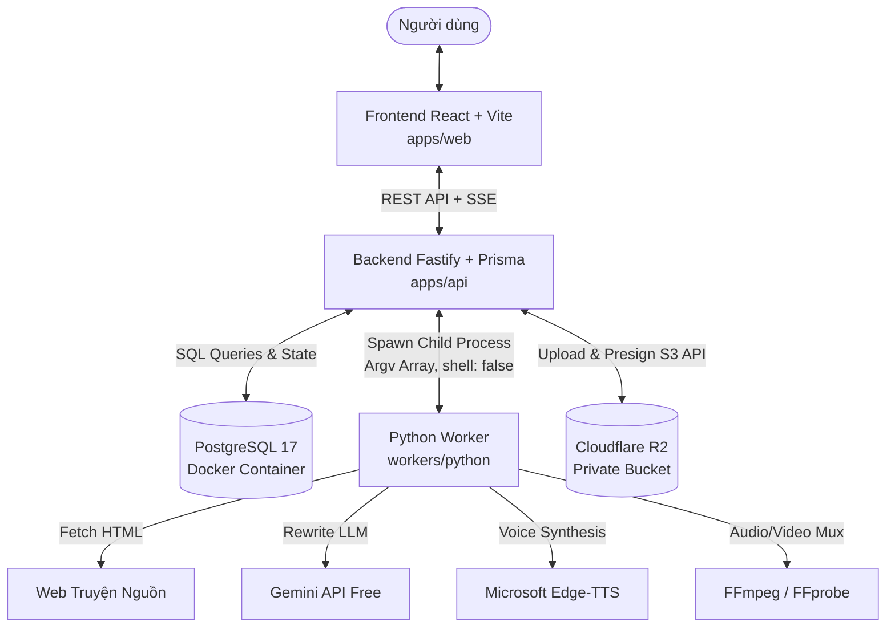

# Kiến trúc Hệ thống (Architecture Overview) — Story Audio v2

## 1. Sơ đồ Tổng quan

---

## 2. Phân định Ranh giới & Trách nhiệm (Boundaries)

### 2.1. Frontend (`apps/web`)
* **Công nghệ:** React, TypeScript, Vite.
* **Vai trò:** Hiển thị form tạo job, cấu hình tham số đóng gói, theo dõi tiến trình trực tiếp qua Server-Sent Events (SSE), hiển thị danh sách chương cần duyệt (`NEEDS_REVIEW`) và cung cấp nút tải sách thành phẩm.
* **Bảo mật:** Tuyệt đối không giữ API key, secret credentials, và không tự xử lý file media dung lượng lớn trong trình duyệt.

### 2.2. Backend API & Job Manager (`apps/api`)
* **Công nghệ:** Node.js v22 LTS, Fastify, Prisma ORM 7.10.1.
* **Vai trò:**
  * Chủ thể duy nhất nắm giữ credentials Cloudflare R2 và kết nối cơ sở dữ liệu PostgreSQL.
  * Điều phối vòng đời Job qua State Machine (`queued` → `running` → `completed` / `needs_review` / `failed`).
  * Khởi tạo tiến trình Python an toàn (`spawn` với `shell: false`), lắng nghe các sự kiện qua luồng `stdout` JSON Lines.
  * Xác thực tính toàn vẹn (checksum SHA-256) của file thành phẩm trước khi đưa lên R2.

### 2.3. Python Worker (`workers/python`)
* **Công nghệ:** Python 3.12, Beautiful Soup 4, Edge-TTS.
* **Vai trò:** Thực thi các tác vụ tính toán chuyên biệt: crawl dữ liệu từ adapter hợp lệ, chuẩn hóa văn bản, chia đoạn an toàn, gọi Gemini Free để viết lại theo thuật ngữ, chạy bộ lọc QA, tạo audio MP3 và đóng gói M4B/MP4 qua FFmpeg.
* **Không gian làm việc:** Chỉ thao tác bên trong thư mục `workdir` tạm thời được backend chỉ định.

### 2.4. Lưu trữ Đám mây (Cloudflare R2)
* **Loại lưu trữ:** S3-compatible Private Object Storage.
* **Vai trò:** Lưu trữ lâu dài các file text, audio từng chương và file M4B/MP4 thành phẩm.
* **Truy cập:** Không cấp quyền truy cập công khai. Người dùng chỉ tải file thông qua presigned URL có thời hạn ngắn (TTL 300s).

---

## 3. Tài liệu Kiến trúc Chi tiết

* **Các quyết định kỹ thuật (ADRs):** Xem [decisions.md](file:///d:/story-audio-v2/docs/architecture/decisions.md) (ADR-001 đến ADR-004).
* **Từ điển dữ liệu & Cơ sở dữ liệu:** Xem [data-dictionary.md](file:///d:/story-audio-v2/docs/architecture/data-dictionary.md).
* **Cấu trúc Object Key trên R2:** Xem [object-keys.md](file:///d:/story-audio-v2/docs/architecture/object-keys.md).
* **Giao thức Worker (Node ↔ Python):** Xem [worker-protocol.md](file:///d:/story-audio-v2/packages/contracts/worker-protocol.md).
